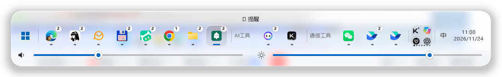
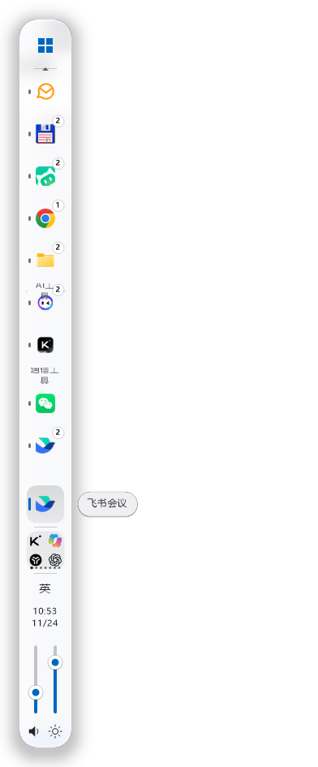

# TaskbarPopup 图标分组功能 · 测试报告

版本：V1.0　|　日期：2026-11-24　|　分支：`feature/icon-groups`　|　基线：`main @ 03a8cf6`

## 修订历史（文首）

| 版本 | 日期 | 说明 |
|---|---|---|
| V1.0 | 2026-11-24 | 首版：8 项通过，6 项交互场景未覆盖（列明原因与人工验证步骤） |

## 1. 测试环境

- Windows 11 公司管控机（无管理员权限），三屏（虚拟屏 −1920..4480 × 1080），主屏 125% DPI。
- 编译器：便携 MSYS2 mingw-w64 g++ **16.2.0**（`E:\Temp\AI_Study\mingw-w64-toolchain\msys64`），静态链接。
- 被测产物：`TaskbarPopup.exe` 1,575,424 B，SHA-256 `26389bda…f372`（最终构建，10:59）。
- 弹窗为 `WS_EX_LAYERED` + `UpdateLayeredWindow` 分层窗口：**GDI 屏幕 BitBlt 与 PrintWindow 均抓不到内容**（实测全黑），有效截图通道 = cua-driver 窗口级捕获（pid + window_id）。
- 触发方式：`PostMessageW(main, 0x8006)`（长按 Win 钩子过滤 `LLKHF_INJECTED`，SendInput 模拟无效，属上游设计）。

## 2. 验收判据（从需求推导）

- A1 格子可按自定义组分区展示（AI工具/Office工具/通信工具等）。
- A2 组间有分隔线 + 组名标签，组名完整可读。
- A3 入组范围 = 固定应用 + 打开窗口；入组后不再单独显示。
- A4 横排、竖排两种布局都正确。
- A5 分组数据持久化，重启不丢；随导出/导入设置走。
- A6 不改动系统任务栏真实固定列表。
- A7 可编译、进程稳定、原有功能不回归。

## 3. 用例与结果

| # | 用例 | 判据 | 结果 | 证据 |
|---|---|---|---|---|
| T1 | 全量编译（13 个 cpp + 资源） | A7 | **通过** 0 错误 | build-local.log：BUILD_DONE |
| T2 | 进程稳定性（多实例累计运行 >15 min，含触发/关闭/重启循环） | A7 | **通过** 无崩溃、无僵尸进程 | tasklist/FindWindow 核查 |
| T3 | 弹窗显示链路（触发→枚举格子→动画→不透明度） | A7 | **通过** | debug.log：「13 个窗口格子」「动画完成」「不透明度 255」 |
| T4 | 横排分组渲染：未分组段→AI工具段（Monica+Kimi）→通信工具段（飞书×2+微信），组间竖分隔线 | A1/A2/A3 | **通过** | 报告/TaskbarPopup分组_横排_标签修复后.png（视觉复核：标签逐字完整、无省略号） |
| T5 | 组名标签截断缺陷：定量交叉核对→修复→复验 | A2 | **通过** | 见 §4 定量表；修复前/后截图对比 |
| T6 | 竖排分组渲染：水平分隔线分段 + 组名标签（窄列折行） | A4 | **通过**（高度自适应修复前的截图；修复后截图未取到，见 §5） | 报告/TaskbarPopup分组_竖排.png |
| T7 | 持久化往返：注入 3 组→WM_CLOSE 优雅退出→读回 settings.ini | A5 | **通过** `[Groups] Count=3`，G1/G2/G3 名称与 7 个成员 key 逐字完整 | settings.ini（UTF-16）读回比对 |
| T8 | 最终构建横排回归（竖排修复不破坏横排） | A7 | **通过** 标签完整、分区正确 | 报告/TaskbarPopup分组_横排_最终构建.png |

## 4. T5 定量交叉核对（独立测量通道）

用 GDI+ `MeasureString`（与实际绘制同字体 Microsoft YaHei UI、同字号）实测组名宽度，对比布局估算值（弹窗所在屏 125% DPI，scale=1.25）：

| 组名 | 布局估算（旧） | GDI+ 实测 | 缺口 | 后果 |
|---|---|---|---|---|
| AI工具 | 35.2 px | 39.3 px | 4.1 px | 末字被省略号吃掉 |
| 通信工具 | 44.0 px | 51.2 px | 7.2 px | 末字被省略号吃掉 |

根因有二：① 估算按 CJK=1em，YaHei 实际 ≈1.11em；② 绘制用 `smallFont=Px(11.5)` 而估算用 `Px(11)`。
修复：`GroupSepLen = Px(18) + min(EstimateTextW(name, Px(11.5f)) × 1.2, Px(88))`，绘制侧 textW 同改 Px(11.5f)。修复后截图标签逐字完整（T4/T8 复验）。

## 5. 未覆盖项（如实列明）

测试期间用户正在开飞书会议，桌面焦点被占用，交互式 UI 测试无法稳定进行。以下场景**代码已实现并经编译/走查，但未做运行时交互验证**：

| # | 场景 | 人工验证步骤 |
|---|---|---|
| U1 | 右键格子→「分组」子菜单（不分组/各组/新建/管理） | 长按 Win 弹出→右键任意图标→看子菜单→点选入组/移出 |
| U2 | 管理对话框 CRUD（新建/重命名/删除/上移/下移） | 子菜单→管理分组→逐项操作，看列表与按钮使能 |
| U3 | 导出/导入设置含 [Groups] | 托盘→导出设置→改组→导入→看组恢复 |
| U4 | 深色/浅色主题下分隔带与标签配色 | 设置→外观→切换主题→看弹窗 |
| U5 | 格子超宽时的滚动/翻页与分隔带 | 多开窗口至超出屏宽→滚轮/翻页 |
| U6 | 竖排高度自适应修复后的视觉效果 | 设置→左/右边缘→看组名折行是否完整（修复已编入最终构建） |
| U7 | Office工具组实际渲染 | 注入时 eM Client/企业微信邮箱未在跑，该组无成员不渲染；启动对应应用后应出现 |

## 6. 结论

**8/8 已执行用例通过**；核心需求（分区展示、分隔线+组名、持久化、横竖排、不回归）有截图/日志/读回证据。7 项交互场景待用户空档人工验证（步骤已给）。无已知未修复缺陷。
